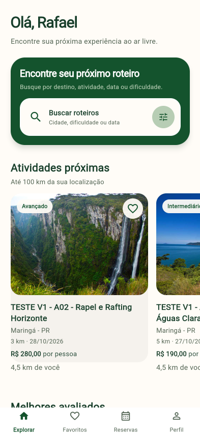
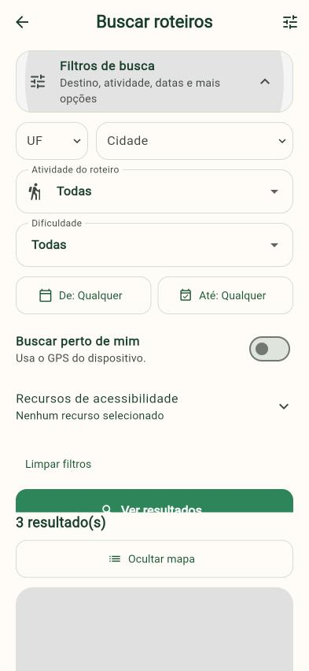
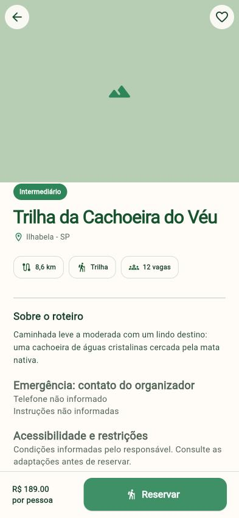
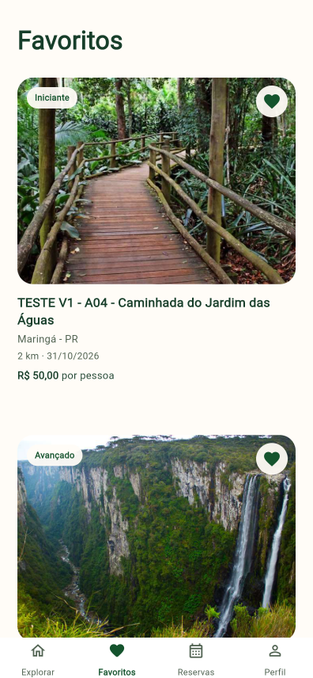
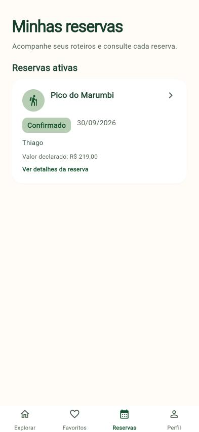
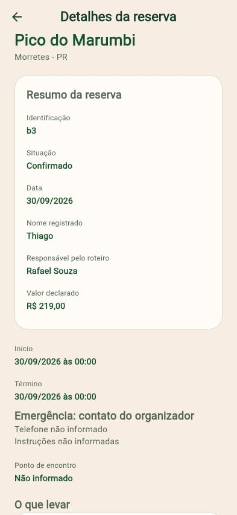
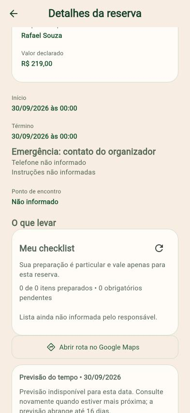

# Guia do turista

**Para quem:** quem criou conta como **Turista**.
**Ao final você saberá:** buscar um roteiro, reservar, acompanhar, cancelar e avaliar.
**Pré-requisito:** conta e login — veja [01-primeiros-passos.md](01-primeiros-passos.md).

[← Voltar ao índice](README.md)

A barra inferior tem quatro abas: **Explorar**, **Favoritos**, **Reservas** e **Perfil**.

## 1. Explorar roteiros

A aba **Explorar** mostra:

- **Atividades próximas** (até 100 km da sua localização);
- **Melhores avaliados**;
- seções por tema: **Roteiros com cachoeira**, **Aquatrekking** e **Acampamentos**.

Na primeira vez, **Atividades próximas** mostra o convite **Usar minha localização**: o pedido de permissão do navegador só aparece quando você toca. Se você já permitiu antes, as atividades carregam sozinhas. Sem localização, use a busca por UF e cidade.

## 2. Buscar com filtros

1. Em Explorar, abra a busca (**Buscar roteiros**).
2. Toque em **Filtros de busca** e combine o que quiser: **UF** e **Cidade**, **Atividade do roteiro**, **Dificuldade**, período (**De** / **Até**) e **Recursos de acessibilidade**.

3. Toque em **Buscar roteiros** ou **Ver resultados**.

| Filtro | Como funciona |
|---|---|
| Atividade | Exemplos: trekking/caminhada, aquatrekking, acampamento, tirolesa, escalada, ciclismo |
| **Buscar perto de mim** | Interruptor que usa o GPS do aparelho. Se negar a permissão, busque por UF e cidade |
| Recursos de acessibilidade | Mostra **somente** roteiros em que o organizador confirmou **todos** os recursos marcados |
| Mapa | **Mostrar mapa / Ocultar mapa** exibe os resultados no mapa |
| **Limpar filtros** | Remove todos os filtros |

Use **Carregar mais roteiros** para ver os próximos resultados.

## 3. Ver os detalhes de um roteiro

A página do roteiro traz dificuldade, distância, atividade e vagas, **Sobre o roteiro**, **Emergência: contato do organizador**, **Acessibilidade e restrições**, **O que levar**, previsão do tempo para a data escolhida, avaliações e o responsável (guia ou agência), com acesso ao perfil e às avaliações dele. O preço por pessoa e o botão **Reservar** ficam fixos na parte de baixo.

> **Acessibilidade e restrições** são condições **informadas pelo organizador**. Itens "Não informado" não significam que o recurso existe. Consulte as adaptações antes de reservar.

Toque no coração para salvar o roteiro em **Favoritos**.

## 4. Reservar

1. Nos detalhes, escolha uma das **datas disponíveis** (se o roteiro não tiver datas, não é possível reservar).
2. Toque em **Reservar** e confira o resumo em **Confirme sua reserva**.
3. Toque em **Solicitar reserva**.

**Resultado esperado:** mensagem *"Solicitação enviada. Aguarde a confirmação do responsável."* A reserva fica **Pendente**.

Regras:

- Não é possível reservar **data passada**.
- Você não pode ter **duas reservas ativas** para a mesma data do mesmo roteiro.
- Se as vagas da data acabarem, a reserva é recusada com *"Não há vagas disponíveis para esta atividade."*
- ⚠️ **Não há pagamento no app.** O valor é declarado pelo organizador e não comprova pagamento.

## 5. Acompanhar suas reservas

Na aba **Reservas** (**Minhas reservas**) você vê as **Reservas ativas** e, quando houver, o **Histórico**, com a opção de **filtrar por período**. Toque em uma reserva (**Ver detalhes da reserva**) para ver situação, datas, responsável, ponto de encontro, o que levar e **Abrir rota no Google Maps**.

Em **O que levar**, o **Meu checklist** é particular: marque os itens que você já preparou, com a contagem de itens preparados e de obrigatórios pendentes. A previsão do tempo aparece logo abaixo, quando disponível (cobre até 16 dias).

| Situação | Significa |
|---|---|
| Pendente | Aguardando o responsável responder |
| Confirmado | O responsável aceitou. Com reserva confirmada, o botão de WhatsApp do responsável é liberado, se ele informou o número |
| Recusado | O responsável não aceitou |
| Cancelado | Reserva cancelada (por você ou pelo responsável) |
| Em andamento | A atividade começou **[depende do check-in, desligado por padrão]** |
| Concluído | O responsável finalizou a saída |

Você recebe notificações a cada resposta ou cancelamento.

## 6. Cancelar uma reserva

1. Abra os detalhes da reserva.
2. Toque em **Cancelar reserva** e confirme em **Confirmar cancelamento**.

Só é possível cancelar reservas **ainda não iniciadas** (pendente, agendada ou confirmada). Reservas em andamento, concluídas ou já canceladas não podem ser canceladas.

## 7. Check-in e check-out **[recurso desligado por padrão]**

Quando ativos na sua instalação, aparecem os botões **Fazer check-in** (ao iniciar) e **Fazer check-out** (ao concluir). Se não aparecerem, o recurso está desativado; o fechamento da atividade é feito pelo responsável (veja [03-guia.md](03-guia.md), "Finalizar a saída").

## 8. Avaliar a experiência

A avaliação é liberada **depois que o responsável finaliza a saída**.

1. Abra a reserva concluída e toque em **Avaliar roteiro, guia e agência**.
2. Dê notas de **0 a 5** e, se quiser, escreva um comentário (até 500 caracteres).
3. Toque em **Publicar avaliação**.

- Você pode **editar por 7 dias** após o primeiro envio. Avaliações ocultadas pela moderação não podem ser editadas.
- Para **denunciar** uma avaliação de outra pessoa, toque em **Denunciar** (motivos: conteúdo ofensivo, exposição de dados pessoais, spam ou outro). Você não pode denunciar a própria avaliação, e cada pessoa denuncia a mesma avaliação uma vez. A administração analisa; não inclua dados pessoais desnecessários.

## 9. Se algo der errado

Veja [06-solucao-de-problemas.md](06-solucao-de-problemas.md).
